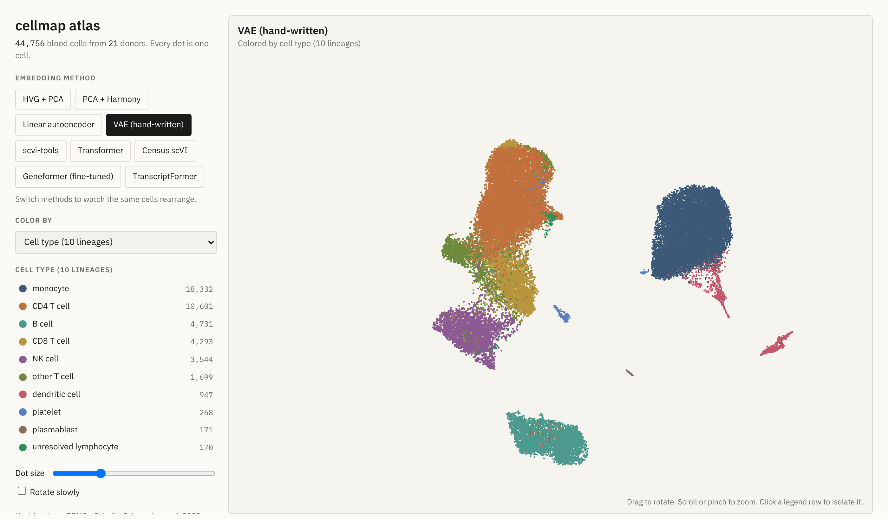
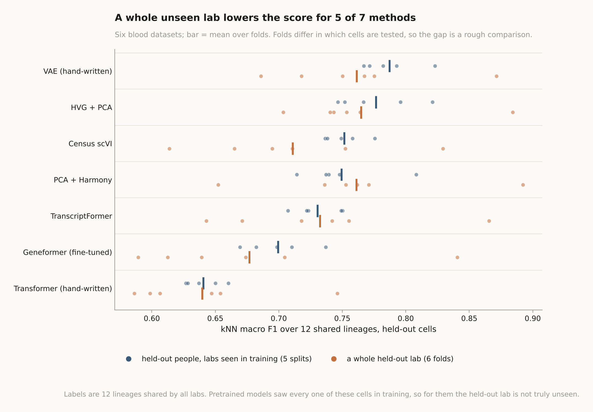
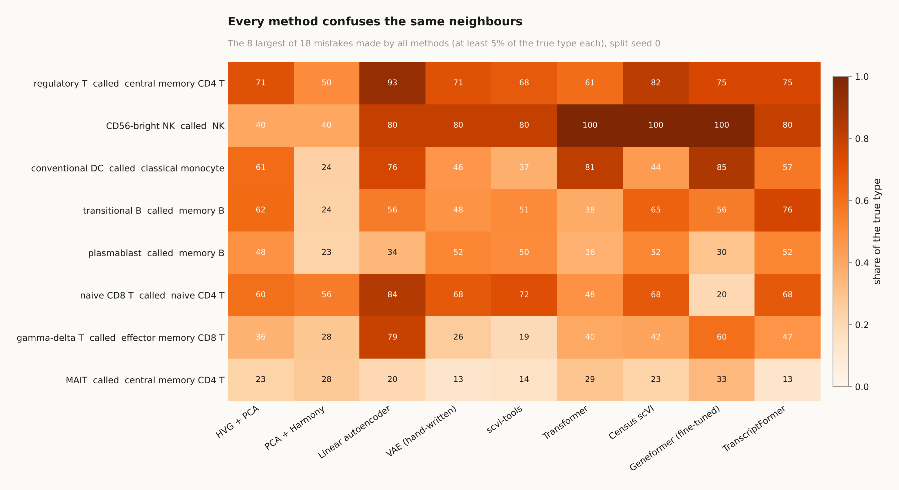
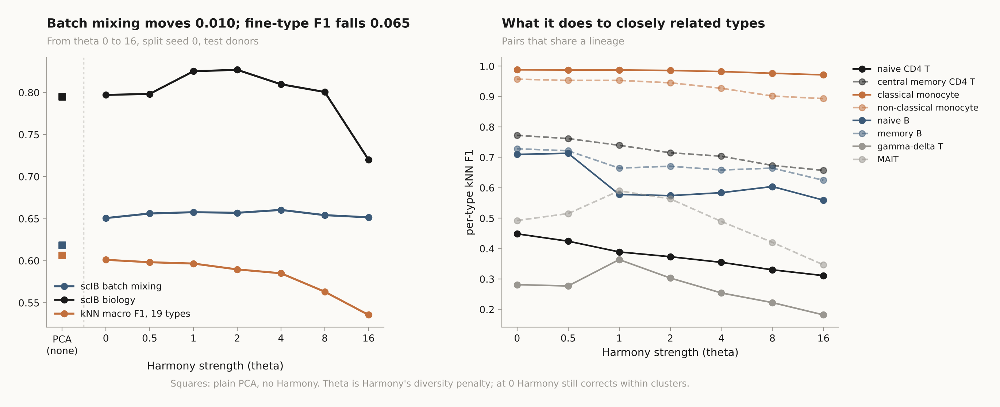
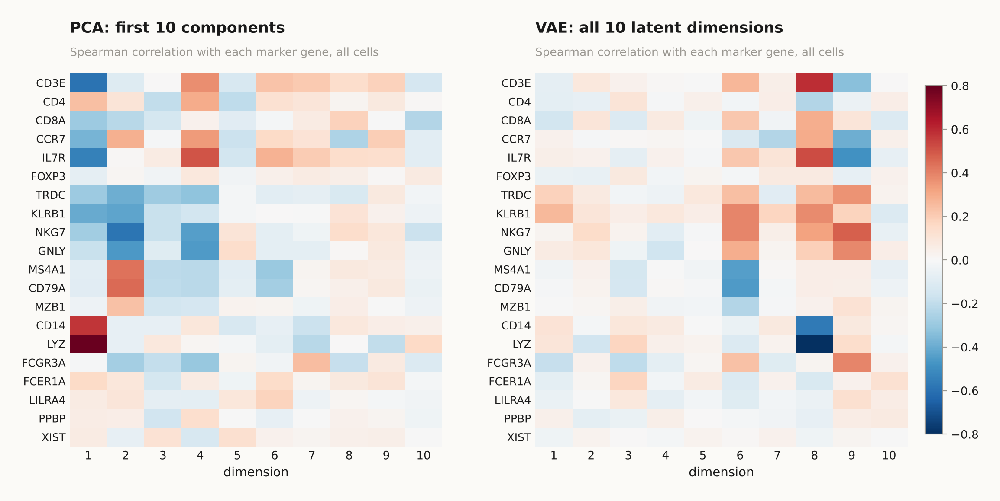
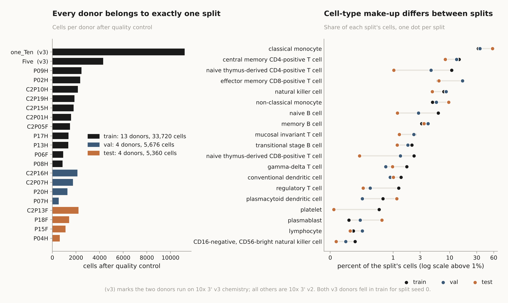

# cellmap



cellmap tests whether deep learning makes better representations of single cells than simple
methods, using public blood data and tests on people and whole labs the models never saw.
I wrote a variational autoencoder and a transformer from scratch, checked the autoencoder
against scvi-tools, and compared both with PCA, Harmony and three published pretrained models
on 44,756 cells from 21 people and then 63,100 cells from six labs.
Under a rule fixed before any deep model was scored, applied to every metric it names, 3 of 68
comparisons passed, all on a single metric (batch mixing, or accuracy with a mean still below
PCA), and none on preserving biology; the numbers, figures, an independent review of these
claims and an interactive 3D atlas are below.

Start with [docs/GUIDE.md](docs/GUIDE.md) for a walkthrough of the whole project. Every
decision is explained in [docs/NOTES.md](docs/NOTES.md), the plan and decision log are in
[docs/PLAN.md](docs/PLAN.md), and the day by day log is in [journal/](journal/README.md).
The site (`site/index.html`, an explainer, and `site/atlas.html`, the atlas) is published
with GitHub Pages once the repository is public (see [docs/RELEASE.md](docs/RELEASE.md)).

## Status

| Milestone | State |
|---|---|
| M0 data pipeline: load, quality control, donor-level split, normalize | built, tests pass |
| M1 classical baselines (HVG + PCA, PCA + Harmony) and evaluation harness | built, results below |
| M2 hand-written negative binomial VAE, linear autoencoder, KL sweep | built, results below |
| M3 parity check against scvi-tools | built; parity holds on all five splits |
| M5 hand-written transformer with masked gene modeling | built; trained on a Colab GPU; results below |
| M6 published pretrained-model embeddings (Census scVI, Geneformer, TranscriptFormer) | built, results below |
| M4 six labs: held-out people, held-out labs, held-out cell type | done, results below |
| M7 analyses: shared confusions, over-correction, marker genes, transformer input encoding | done, results below |
| M8 Harmony fitted without the test cells (reference mapping) | done, results below |
| leakaudit, the reusable audit package (`audit/`) | built, 43 tests, in CI |
| Public release | checklist in `docs/RELEASE.md`; license and visibility are the owner's decisions |
| Public site | scroll-driven explainer (`site/index.html`) and 3D atlas of every method (`site/atlas.html`) |

## Results: every method on the same five donor splits

One dataset (healthy PBMCs, 21 donors), five donor-level splits with 4 held-out donors each,
all scores on held-out donors, means over the five splits. Written by `scripts/m1_baselines.py`,
`scripts/m2_vae.py`, `scripts/m3_scvi_parity.py`, `scripts/m5_transformer.py` (run on a Colab
GPU) and `scripts/m6_pretrained.py` to `results/m1/` through `results/m6/`.

| Method (dimensions) | kNN accuracy, fine | kNN macro F1, fine | scIB bio | scIB batch | scIB aggregate |
|---|---|---|---|---|---|
| PCA + Harmony (50) | 0.856 | 0.657 | 0.801 | 0.662 | 0.746 |
| scvi-tools, settings matched to the VAE (10) | 0.884 | 0.646 | 0.744 | 0.599 | 0.686 |
| VAE, hand-written (10) | 0.879 | 0.646 | 0.737 | 0.600 | 0.682 |
| HVG + PCA (50) | 0.893 | 0.664 | 0.735 | 0.569 | 0.669 |
| Census scVI (50) | 0.841 | 0.533 | 0.746 | 0.550 | 0.668 |
| HVG + PCA (10) | 0.846 | 0.525 | 0.733 | 0.527 | 0.651 |
| Linear autoencoder (10) | 0.842 | 0.519 | 0.730 | 0.530 | 0.650 |
| Geneformer, fine-tuned (512) | 0.719 | 0.367 | 0.643 | 0.484 | 0.580 |
| TranscriptFormer TF-Sapiens (2048) | 0.892 | 0.629 | 0.662 | 0.442 | 0.574 |
| Transformer, hand-written (128) | 0.745 | 0.371 | 0.554 | 0.481 | 0.525 |

The rule for "better" was fixed before any deep model was scored: higher than both baselines in
at least 4 of 5 splits, on any of six metrics (scIB bio, scIB batch, kNN accuracy and macro F1 at
the fine and coarse level). `scripts/verify_rule.py` applies it to every method and metric
(`results/verify/rule_table.csv`). By that rule:

- On this dataset one comparison of 50 passed: scvi-tools on fine kNN accuracy (higher than PCA
  in 4 of 5 splits and than Harmony in 5 of 5, but its mean is 0.008 below PCA). An earlier
  version of this README said no method passed; that check had covered only two of the six
  metrics. With five overlapping splits the rule has little power: a method no better than one
  baseline would clear 4 of 5 against it about 19 percent of the time by chance.
- The hand-written VAE matched 50-dimensional PCA with 10 dimensions and was higher on batch
  correction in 4 of 5 splits, but lower than Harmony on every scIB score in 5 of 5.
- The hand-written VAE and scvi-tools with matched settings agree on every metric within
  noise (no difference larger than 0.01 on average, none consistent across splits). This is the
  check that the hand-written model is correct.
- The hand-written transformer learned its masked-gene task (4.5 to 8.6 points above guessing
  each gene's usual level on validation donors) but its embedding was lower than PCA, Harmony
  and the VAE on all five table columns in all 5 splits (not on every scIB sub-metric: its
  iLISI is above PCA's in 5 of 5).
- None of the three published pretrained embeddings passed the rule against PCA on any metric
  here, though Census scVI has a higher mean scIB bio score than PCA (0.746 against 0.735).
  What they saw in training differs: Census scVI was trained, without labels, on Census cells
  that include most of these; the Census Geneformer was fine-tuned with cell-type labels on
  CELLxGENE data that may include them; TranscriptFormer's training set was not checked.

Limits: one dataset; five splits give a direction, not a precise size; embedding sizes differ
(10 to 2048); Harmony is transductive (it sees held-out donors' expression, never their labels);
scIB metrics are computed without the cross-method scaling used in the scIB paper;
the scIB biological-conservation score moved by up to 0.07 between two runs of the same model that
differed only in CPU thread count (one comparison, recorded in `docs/NOTES.md`, not under
`results/`), so small differences in that column are noise. The five splits are not
interchangeable: two of the 21 donors are the only 10x 3' v3 samples, split 1 tests on one of
them (a quarter of all cells), and split 3 tests on the other with no v3 cells left in training,
so it is a chemistry hold-out (`results/verify/pbmc_split_composition.csv`). Per-split results
should be read with that table.


## M4: six labs, whole labs held out

Six healthy blood datasets from different labs and 10x chemistries, 63,100 cells from 128 donors,
labels mapped to 12 shared lineages, only genes every lab measured. Each method is scored on
held-out people (5 donor splits) and on a whole held-out lab (6 folds). Numbers from
`results/m4/m4_blood/`, written by `scripts/m4_benchmark.py` (the transformer on a Colab GPU).

| Method | Macro F1, held-out people | Macro F1, held-out lab | scIB aggregate, held-out people | scIB aggregate, held-out lab |
|---|---|---|---|---|
| VAE (hand-written) | 0.787 | 0.761 | 0.689 | 0.715 |
| HVG + PCA | 0.776 | 0.765 | 0.621 | 0.713 |
| Census scVI | 0.751 | 0.711 | 0.650 | 0.691 |
| PCA + Harmony | 0.749 | 0.761 | 0.702 | 0.719 |
| TranscriptFormer | 0.730 | 0.732 | 0.509 | 0.665 |
| Geneformer (fine-tuned) | 0.699 | 0.677 | 0.560 | 0.699 |
| Transformer (hand-written) | 0.641 | 0.640 | 0.539 | 0.562 |



- Under the pre-declared rule, two comparisons of 18 passed on held-out people, both on batch
  correction: the hand-written VAE (higher than PCA and Harmony in 5 of 5 splits, by 0.037 and
  0.026 on average) and Census scVI (5 of 5 and 4 of 5). None passed on biological
  conservation, accuracy or macro F1. For held-out labs (6 folds, no threshold declared in
  advance; 5 of 6 used) none passed.
- The hand-written VAE gained the most from more data: on held-out people its macro F1 is above
  PCA in 3 of 5 splits and above Harmony in 4 of 5 (0.787 against 0.776 and 0.749), short of
  the rule.
- On a whole unseen lab, PCA, Harmony and the VAE are within 0.004 of each other on macro F1.
- Held-out cell type (split seed 0 only): B cells removed from training still group together
  and are labelled plasma cells, their closest relatives; dendritic cells are labelled
  monocytes and lose some grouping (`results/m4/m4_blood/heldout_types.csv`).

Limits: labels are coarse (12 lineages), so these scores are not comparable with the 19-type
scores above; a held-out-lab test set has a different cell-type mix from a donor-split test set,
so the two columns are only roughly comparable; all six datasets are in Census, and Census scVI
was trained with each dataset as a batch covariate, so for it no lab is truly held out; on a
held-out lab the scIB batch score measures mixing of donors within that one lab, not across
labs.

Two further checks (`results/leakage/splits.csv`, `results/probe/pbmc/probe_inputs.csv`):

- A random cell split gave higher macro F1 than a donor split: by 0.112 on the 21-donor data
  (random 0.767 to 0.784 across seeds, donor 0.595 to 0.788) and by 0.007 against held-out
  people on six labs (0.018 against a held-out lab). On the 21-donor data most of the gap comes
  from splits 0 and 3, and split 3 is a chemistry hold-out, so part of it is distribution shift
  rather than leakage. Accuracy differs much less (0.017), so the gap is mostly in rare types.
- For the hand-written transformer, giving only which genes are on, with every amount set to
  one, scored the same as the real input (macro F1 0.375 against 0.366), while shuffling the
  amounts within each cell cut it to 0.164. So the model does read expression levels, but the
  true levels added nothing measurable over presence alone. One model, one split, one seed, and
  a weak model (PCA scores 0.606 on the same split).

## M7: what the methods get wrong, and where correction goes too far

On the PBMC data, split seed 0 (`results/m7/pbmc/`, written by `scripts/m7_analyses.py`).

**Every method makes the same mistakes.** 18 confusions appear in all nine methods (each at
least 5 percent of the true type; the figure shows the 8 largest). The largest are between close
relatives: regulatory T cells called central memory CD4 T cells (50 to 93 percent of them,
depending on the method), CD56-bright NK cells called NK cells, transitional B cells called
memory B cells, naive CD8 T cells called naive CD4 T cells. A few smaller ones are not, such as
plasmablasts called CD4 T cells (at least 7 percent). Harmony reduces several of them; no method
removes them.



**Turning Harmony up past its default costs biology without mixing donors further.** From theta 0
to 16 the batch score stays between 0.651 and 0.660, while fine-type macro F1 falls steadily from
0.601 to 0.536 (0.590 at the default, theta 2) and the scIB biology score falls from 0.827 to
0.720 between theta 2 and 16. The aggregate score is highest near the default, so this is
over-correction above the default, mostly at theta 16, not a case against Harmony. Plain PCA, with
no correction, scores 0.606 macro F1 and 0.619 batch on the same split. One split only (seed 0,
the split where Harmony's lead is smallest); not repeated on the others.



**Learned directions match known markers, less cleanly than PCA's.** PCA's first component
tracks the monocyte gene LYZ (Spearman 0.79) and its second the NK gene NKG7 (-0.58). The VAE has
one similarly clear direction (dimension 8, counting from 1 as in the figure, with LYZ, -0.80); its other dimensions mix markers.



**A better level encoding did not give a better cell embedding.** The probe suggested the
transformer's rank encoding was the problem (57 percent of training tokens in one bin,
`results/m7/pbmc/token_bins.csv`). The same model retrained with depth-normalised value bins
(10 percent of tokens in each) learned its masked-level task far better (validation accuracy 0.780
against 0.270 for guessing each gene's usual level, where the rank model had 0.749 against 0.682),
but its embedding was no better: fine macro F1 0.348 against 0.366, and presence-only input scored
higher still (0.418). So the encoding was not what held the embedding back; predicting expression
levels did not teach this model cell types. One split, one seed, trained on CPU where the rank
model was trained on a GPU (`results/m7/pbmc/transformer_levels.csv`, written by
`scripts/m7_transformer_levels.py`).

## M8: was Harmony's lead fair?

Harmony was the only method that corrected held-out cells together with training cells. Fitted
on training donors only, with held-out cells mapped onto the frozen reference (Symphony algorithm,
`src/cellmap/reference_mapping.py`), it scored lower than the usual Harmony in 5 of 5 splits on the
21-donor dataset: 0.024 of its 0.077 scIB lead over PCA on average, but 3 to 50 percent of the
lead depending on the split, and 22 to 31 percent on average depending on the query ridge
(`results/m8/pbmc/`). The loss is mostly in the biology score. On six labs it lost nothing on
held-out people (+0.003, higher in 4 of 5); on held-out labs Harmony led PCA by only 0.006, so
there was little to lose. This compares two procedures (joint Harmony against a reference
mapping), so it shows that part of Harmony's lead on small data depends on seeing the test cells,
not exactly how much.

## leakaudit: the checks, as a reusable package

[`audit/`](audit/README.md) is a small standalone package (`leakaudit`, numpy, pandas and
scikit-learn only) that turns this project's honesty checks into five-line tools for any
biological ML project: group-aware splits with an overlap guarantee and a balance report,
measured inflation from a leaky split (row-level, or preprocessing fitted on all data), and
shortcut probes that shuffle one named input block at a time. Its PBMC example reproduces the
leakage numbers in `results/leakage/splits.csv` exactly. The README compares it honestly with
existing tools (scikit-learn's group splitters, DataSAIL, deepchecks and others).

## M1 detail: PCA versus PCA + Harmony

One dataset (healthy PBMCs, 21 donors), five donor-level splits, 4 held-out donors each.
All scores are on held-out donors. Numbers are from
[`results/m1/pbmc/summary.csv`](results/m1/pbmc/summary.csv) and
[`paired_harmony_minus_pca.csv`](results/m1/pbmc/paired_harmony_minus_pca.csv), written by
`scripts/m1_baselines.py`.

| Metric | HVG + PCA | PCA + Harmony | Paired change | Splits where Harmony is higher |
|---|---|---|---|---|
| scIB biological conservation | 0.735 | 0.801 | +0.066 | 5 of 5 |
| scIB batch correction | 0.569 | 0.662 | +0.093 | 5 of 5 |
| scIB aggregate (0.6 bio + 0.4 batch) | 0.669 | 0.746 | +0.077 | 5 of 5 |
| kNN accuracy, 19 fine cell types | 0.893 | 0.856 | -0.037 | 0 of 5 |
| kNN macro F1, 19 fine cell types | 0.664 | 0.657 | -0.007 | 2 of 5 |


Harmony scored higher on the integration metrics in every split and lower on fine-label kNN
accuracy in every split, so which baseline is better depends on the metric.

Read these numbers with their limits:

- Harmony is transductive: it adjusts all cells it is given, so held-out donors' cells take
  part through their expression and donor label (never their cell type). PCA and gene
  selection are fitted on training donors only.
- Five splits of one dataset give a consistent direction and a poor estimate of size.
- scIB metrics come from `scib-metrics` 0.6.2 called metric by metric, without the min-max
  scaling across methods used in the scIB paper, so they are not comparable to published tables.
- Sequencing chemistry is confounded with donor in this dataset (2 of 21 donors are 10x v3).

## M0 result: the dataset and its split



Data: healthy-donor blood cells (PBMCs) from Schulte-Schrepping et al., Cell 2020, downloaded
from CZ CELLxGENE Census release 2025-01-30 (dataset `5e717147-0f75-4de1-8bd2-6fda01b8d75f`).
Every number below was written by `scripts/m0_prepare_data.py` to
[`results/m0/pbmc/`](results/m0/pbmc/).

| | cells | donors | fine cell types |
|---|---|---|---|
| downloaded | 45,787 | 21 | 20 |
| after quality control | 44,756 | 21 | 19 |
| train | 33,720 | 13 | 19 |
| val | 5,676 | 4 | 19 |
| test | 5,360 | 4 | 19 |

Donors shared between any two splits: 0 (checked in code on every run, and by unit tests).
After filtering, 18,002 genes remain. The gene filter (expressed in at least 10 training cells)
uses split seed 0's training donors, and the same gene list is used for all five splits, so for
seeds 1 to 4 it saw some of their test donors. It is a loose filter that only drops genes almost
never expressed, but it is not fitted per split. Gene selection (HVG) and PCA are fitted per
split on training donors only.

Known limits of this split, stated up front:

- Both donors sequenced with the 10x 3' v3 chemistry landed in train, so this split does not
  test generalization to an unseen chemistry.
- One donor contributes 11,195 of the 33,720 training cells.
- Some cell types are very rare in the held-out donors (for example 3 platelets in test), so
  per-type scores for those types will be noisy.
- This is one split with one seed. M1 repeats over five donor splits.

## Data and citations

All data come from CZ CELLxGENE Census, release 2025-01-30 (CC BY 4.0), downloaded by the
scripts in this repository and not stored in it. Please cite the original studies:

| Name in this repository | Study | DOI |
|---|---|---|
| `pbmc`, and `schulte` in M4 | Schulte-Schrepping et al. 2020, Cell; hosted on CELLxGENE in the collection of Jin et al. 2021, iScience | 10.1016/j.isci.2021.103115 (collection) |
| `hao` | Hao et al. 2021, Cell | 10.1016/j.cell.2021.04.048 |
| `stephenson` | Stephenson et al. 2021, Nature Medicine | 10.1038/s41591-021-01329-2 |
| `combat` | COMBAT Consortium (Ahern et al.) 2022, Cell | 10.1016/j.cell.2022.01.012 |
| `aida` | Kock et al. 2024, bioRxiv (Asian Immune Diversity Atlas) | 10.1101/2024.06.30.601119 |
| `onek1k` | Yazar et al. 2022, Science | 10.1126/science.abf3041 |

Methods compared: Harmony (Korsunsky et al. 2019), scVI / scvi-tools (Lopez et al. 2018),
Geneformer (Theodoris et al. 2023), TranscriptFormer (CZI, 2025), scIB metrics (Luecken et al.
2022, via `scib-metrics`). The question follows Kedzierska et al. 2025 (Genome Biology).

## Reproduce

```bash
pip install -e ".[dev,data,figures]"
python scripts/m0_prepare_data.py --config configs/pbmc.yaml   # downloads about 450 MB once
python scripts/m0_figures.py --name pbmc
python scripts/m1_baselines.py --name pbmc                      # about 2 minutes on 4 CPU cores
python scripts/m1_figures.py --name pbmc
python scripts/m2_vae.py --name pbmc                           # about 30 minutes on 4 CPU cores
python scripts/m2_kl_sweep.py --name pbmc
python scripts/m2_figures.py --name pbmc
python scripts/m3_scvi_parity.py --name pbmc                   # about 30 minutes
python scripts/m6_pretrained.py --name pbmc                    # downloads about 4 GB of embeddings
python scripts/m4_prepare_data.py --config configs/m4_blood.yaml
python scripts/m4_benchmark.py --name m4_blood                 # transformer: notebooks/m4_transformer_gpu.ipynb
python scripts/m4_heldout_type.py --name m4_blood
python scripts/m4_figures.py --name m4_blood
python scripts/atlas_export.py --name pbmc                      # site/atlas.html
python scripts/explainer_export.py --name pbmc                  # site/index.html
pytest -q
```

`configs/tiny.yaml` runs the same pipeline on 150 cells per donor in a few seconds once the
download is cached.
