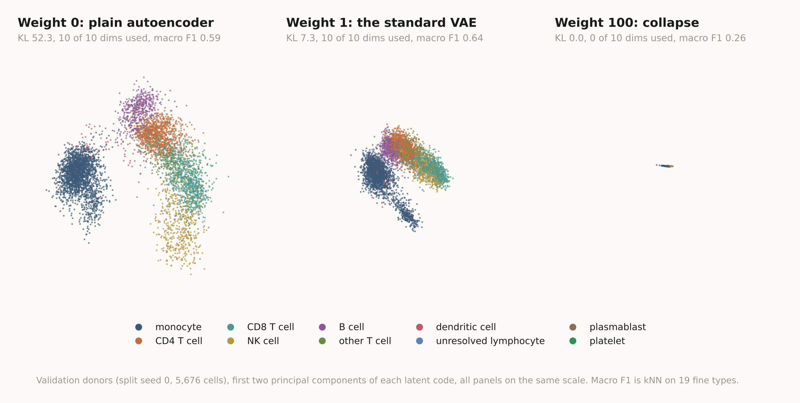
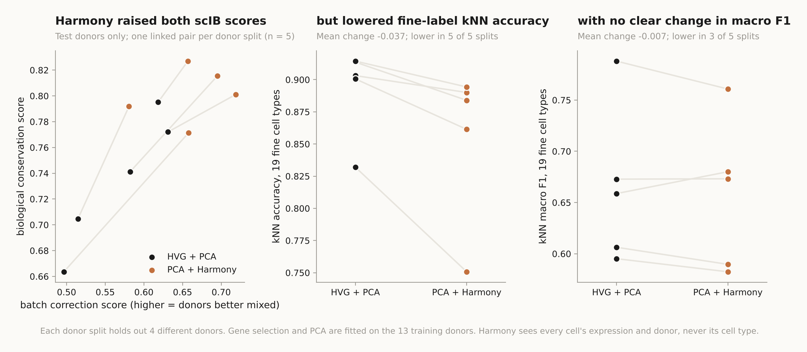

# cellmap


cellmap asks how much deep models add over simple baselines for representing single cells
from gene-expression data, using public data and splits that prevent leakage.
It is a work in progress: the data pipeline and the two classical baselines are built and
scored on one dataset, and no deep model result exists yet.
The plan is in [docs/PLAN.md](docs/PLAN.md), the reasoning behind every decision in
[docs/NOTES.md](docs/NOTES.md), and the day by day log in [journal/](journal/README.md).

## Status

| Milestone | State |
|---|---|
| M0 data pipeline: load, quality control, donor-level split, normalize | built, tests pass |
| M1 classical baselines (HVG + PCA, PCA + Harmony) and evaluation harness | built, results below |
| M2 hand-written negative binomial VAE, linear autoencoder, KL sweep | built, results below |
| M3 parity check against scvi-tools | built; parity holds on all five splits |
| M5 hand-written transformer with masked gene modeling | built and tested; not yet trained on the full data (needs a GPU) |
| M6 published pretrained-model embeddings (Census scVI, Geneformer, TranscriptFormer) | built, results below |
| M4 scale-up, M7 analyses and write-up | not started |
| Interactive 3D atlas | first version built (`site/index.html`) |

## Results so far: every method on the same five donor splits

One dataset (healthy PBMCs, 21 donors), five donor-level splits with 4 held-out donors each,
all scores on held-out donors, means over the five splits. Written by `scripts/m1_baselines.py`,
`scripts/m2_vae.py`, `scripts/m3_scvi_parity.py` and `scripts/m6_pretrained.py` to
`results/m1/`, `results/m2/`, `results/m3/` and `results/m6/`.

| Method (dimensions) | kNN accuracy, fine | kNN macro F1, fine | scIB bio | scIB batch | scIB aggregate |
|---|---|---|---|---|---|
| PCA + Harmony (50) | 0.856 | 0.657 | 0.801 | 0.662 | 0.746 |
| scvi-tools, settings matched to the VAE (10) | 0.884 | 0.646 | 0.744 | 0.599 | 0.686 |
| VAE, hand-written (10) | 0.879 | 0.646 | 0.737 | 0.600 | 0.682 |
| HVG + PCA (50) | 0.893 | 0.664 | 0.735 | 0.569 | 0.669 |
| Census scVI (50) | 0.841 | 0.533 | 0.746 | 0.550 | 0.668 |
| HVG + PCA (10) | 0.846 | 0.525 | 0.733 | 0.527 | 0.651 |
| Linear autoencoder (10) | 0.842 | 0.519 | 0.730 | 0.530 | 0.650 |
| Geneformer, fine-tuned (512) | 0.719 | 0.367 | 0.643 | 0.484 | 0.580 |
| TranscriptFormer TF-Sapiens (2048) | 0.892 | 0.629 | 0.662 | 0.442 | 0.574 |

The rule for "better" was fixed before any deep model was scored: higher than both baselines in
at least 4 of 5 splits. By that rule:

- No method beat both HVG + PCA and PCA + Harmony.
- The hand-written VAE matched 50-dimensional PCA with 10 dimensions and was higher on batch
  correction in 4 of 5 splits, but lower than Harmony on every scIB score in 5 of 5.
- The hand-written VAE and scvi-tools with matched settings agree on every metric within
  noise (no difference larger than 0.01 on average, none consistent across splits). This is the
  check that the hand-written model is correct.
- None of the three published pretrained embeddings beat plain PCA on any metric, although all
  three were trained on Census data that includes these cells, and the Census Geneformer was
  fine-tuned with cell-type labels.

Limits: one dataset; five splits give a direction, not a precise size; embedding sizes differ
(10 to 2048); Harmony is transductive (it sees held-out donors' expression, never their labels);
scIB metrics are computed without the cross-method scaling used in the scIB paper;
the scIB biological-conservation score moved by up to 0.07 between two runs of the same model that
differed only in CPU thread count, so small differences in that column are noise.



## M1 detail: PCA versus PCA + Harmony

One dataset (healthy PBMCs, 21 donors), five donor-level splits, 4 held-out donors each.
All scores are on held-out donors. Numbers are from
[`results/m1/pbmc/summary.csv`](results/m1/pbmc/summary.csv) and
[`paired_harmony_minus_pca.csv`](results/m1/pbmc/paired_harmony_minus_pca.csv), written by
`scripts/m1_baselines.py`.

| Metric | HVG + PCA | PCA + Harmony | Paired change | Splits where Harmony is higher |
|---|---|---|---|---|
| scIB biological conservation | 0.735 | 0.801 | +0.066 | 5 of 5 |
| scIB batch correction | 0.569 | 0.662 | +0.093 | 5 of 5 |
| scIB aggregate (0.6 bio + 0.4 batch) | 0.669 | 0.746 | +0.077 | 5 of 5 |
| kNN accuracy, 19 fine cell types | 0.893 | 0.856 | -0.037 | 0 of 5 |
| kNN macro F1, 19 fine cell types | 0.664 | 0.657 | -0.007 | 2 of 5 |



Harmony scored higher on the integration metrics in every split and lower on fine-label kNN
accuracy in every split, so which baseline is better depends on the metric.

Read these numbers with their limits:

- Harmony is transductive: it adjusts all cells it is given, so held-out donors' cells take
  part through their expression and donor label (never their cell type). PCA and gene
  selection are fitted on training donors only.
- Five splits of one dataset give a consistent direction and a poor estimate of size.
- scIB metrics come from `scib-metrics` 0.6.2 called metric by metric, without the min-max
  scaling across methods used in the scIB paper, so they are not comparable to published tables.
- Sequencing chemistry is confounded with donor in this dataset (2 of 21 donors are 10x v3).

## M0 result: the dataset and its split


Data: healthy-donor blood cells (PBMCs) from Schulte-Schrepping et al., Cell 2020, downloaded
from CZ CELLxGENE Census release 2025-01-30 (dataset `5e717147-0f75-4de1-8bd2-6fda01b8d75f`).
Every number below was written by `scripts/m0_prepare_data.py` to
[`results/m0/pbmc/`](results/m0/pbmc/).

| | cells | donors | fine cell types |
|---|---|---|---|
| downloaded | 45,787 | 21 | 20 |
| after quality control | 44,756 | 21 | 19 |
| train | 33,720 | 13 | 19 |
| val | 5,676 | 4 | 19 |
| test | 5,360 | 4 | 19 |

Donors shared between any two splits: 0 (checked in code on every run, and by unit tests).
After filtering, 18,002 genes remain; the gene filter is fitted on training donors only.

Known limits of this split, stated up front:

- Both donors sequenced with the 10x 3' v3 chemistry landed in train, so this split does not
  test generalization to an unseen chemistry.
- One donor contributes 11,195 of the 33,720 training cells.
- Some cell types are very rare in the held-out donors (for example 3 platelets in test), so
  per-type scores for those types will be noisy.
- This is one split with one seed. M1 repeats over five donor splits.

## Reproduce

```bash
pip install -e ".[dev,data,figures]"
python scripts/m0_prepare_data.py --config configs/pbmc.yaml   # downloads about 450 MB once
python scripts/m0_figures.py --name pbmc
python scripts/m1_baselines.py --name pbmc                      # about 2 minutes on 4 CPU cores
python scripts/m1_figures.py --name pbmc
python scripts/m2_vae.py --name pbmc                           # about 30 minutes on 4 CPU cores
python scripts/m2_kl_sweep.py --name pbmc
python scripts/m2_figures.py --name pbmc
python scripts/m3_scvi_parity.py --name pbmc                   # about 30 minutes
python scripts/m6_pretrained.py --name pbmc                    # downloads about 4 GB of embeddings
python scripts/atlas_export.py --name pbmc
pytest -q
```

`configs/tiny.yaml` runs the same pipeline on 150 cells per donor in a few seconds once the
download is cached.
