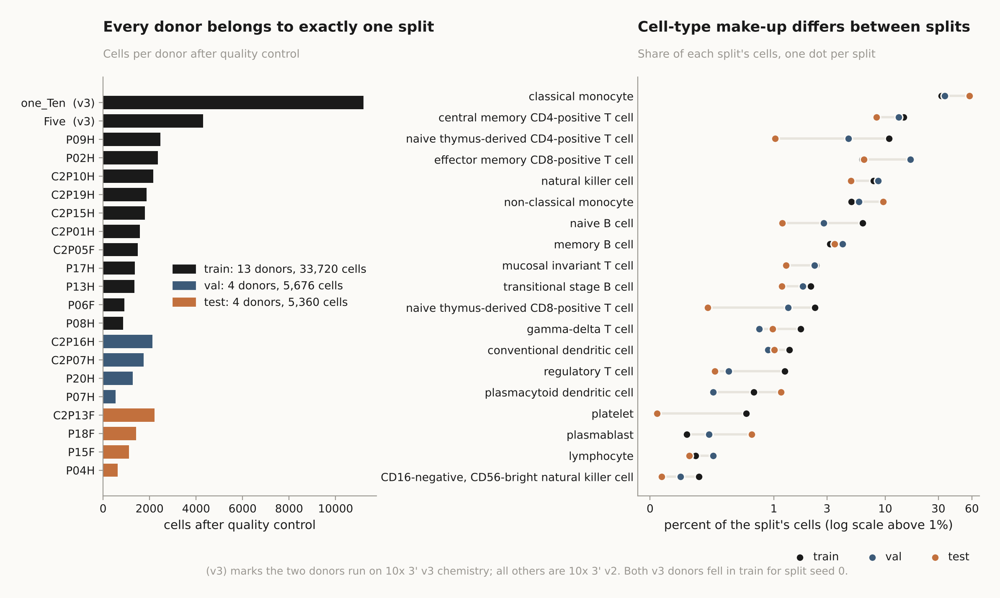
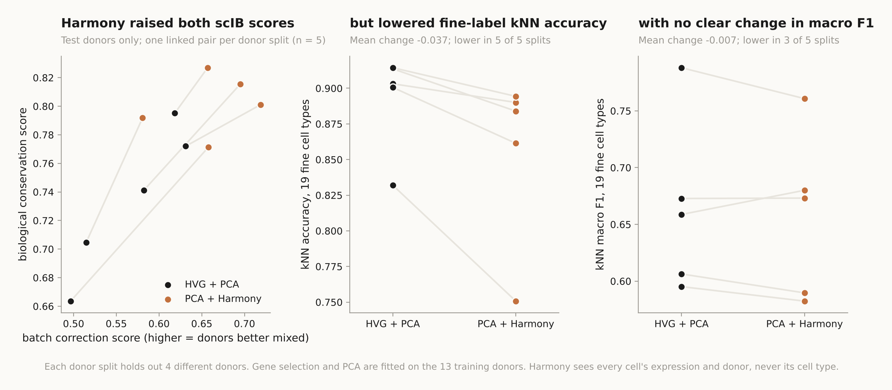
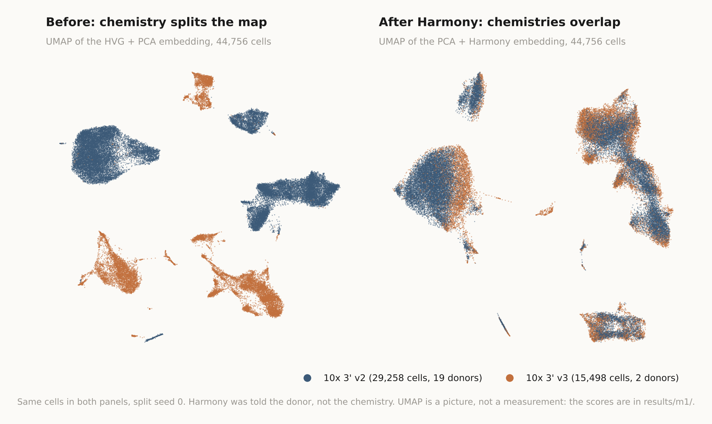
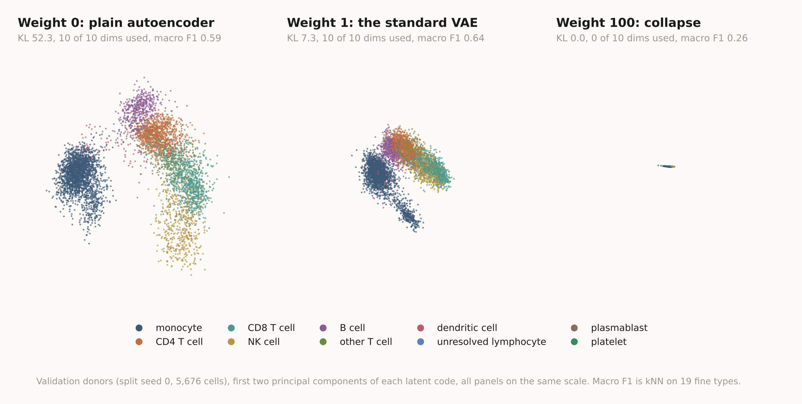
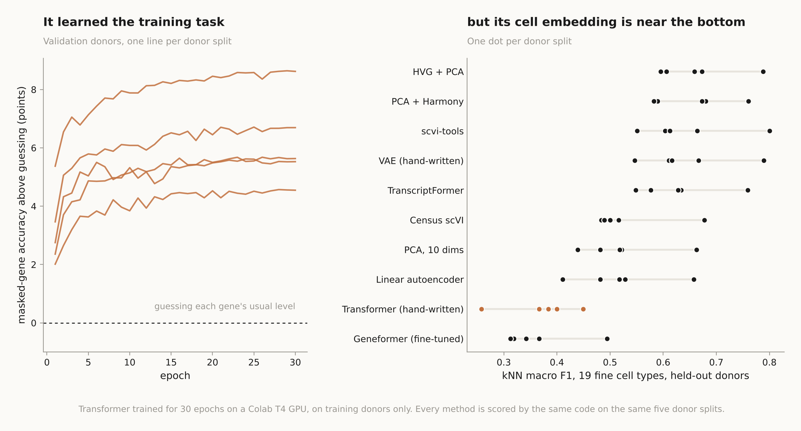

# November 17, 2026

First day. The repo held only the plan. The goal was a data pipeline with donor-level splits (M0), then the two classical baselines and the code that scores any embedding (M1). The work was done by Claude with parallel subagents at the owner's request ("full speed, learn afterwards"), with every decision written to `docs/NOTES.md`.

## Picking the dataset

The plan said "a standard blood dataset (PBMC)". The standard one, PBMC 3k, has a single donor, so it cannot be split by donor. I looked through healthy blood datasets in CELLxGENE Census release 2025-01-30 for something small with many donors.

The first candidate (Binvignat et al. 2024, 18 control donors) looked right on paper and was wrong on inspection: median 388 UMIs per cell. Rejected before any code depended on it.

Chosen: Schulte-Schrepping et al. 2020 healthy controls. 45,787 cells, 21 donors, 20 cell types, two 10x chemistries.

## The pipeline (M0)

Order: cell QC with fixed thresholds, drop types under 50 cells, split by donor, gene filter on training donors, normalize.

**44,756 cells, 21 donors, 19 fine cell types, 18,002 genes. Train 13 donors, val 4, test 4. Donors shared between splits: 0.**

QC removed 991 cells: 231 under 500 UMIs, 761 over 15 percent mitochondrial, one failing both. One cell type was dropped (double negative thymocyte, 40 cells).

## What the split looks like, stated plainly

Split seed 0 is not a balanced split, and I did not pick another seed to make it look better.

- Both v3 chemistry donors are in train. This split cannot test an unseen chemistry.
- One donor (one_Ten) holds 11,195 of the 33,720 training cells.
- Classical monocytes are 57 percent of test cells and 32 percent of training cells.
- Test has 3 platelets and 5 CD56-bright NK cells.

This is the reason M1 uses five donor splits.

Script: `scripts/m0_prepare_data.py`. Results: `results/m0/pbmc/`.

## Baselines and the evaluation harness (M1)

Two subagents wrote these in parallel: one the baselines (`src/cellmap/baselines.py`), one the scoring code (`src/cellmap/evaluate.py`). I reviewed both and wrote the script that joins them.

Setup: 2,000 highly variable genes selected per training donor, PCA with 50 components fitted on training donors, Harmony on the PCA coordinates with donor as the batch. Five donor splits, 4 test donors each. Scored on test donors only.

**Harmony minus PCA, mean over five splits: scIB aggregate +0.077 (higher in 5 of 5). kNN accuracy on 19 fine types -0.037 (lower in 5 of 5). kNN macro F1 on fine types -0.007 (no detectable difference).**

If Harmony were simply better, both metric families would move the same way. They did not. The integration metrics reward mixing donors and matching clusters to types. Fine-label kNN accuracy depends on small distances between close subtypes, and mixing donors appears to cost some of that.

## The chemistry effect is the dominant structure before correction

On the PCA embedding the v2 and v3 cells form separate islands for every cell type. After Harmony they overlap. Harmony was told only the donor.

A caution worth writing down: chemistry is confounded with donor here. Only two donors are v3 and no donor was run on both. The picture shows that these two donors separate from the other nineteen; that the cause is chemistry is the likely reading, not a tested one.

## Things that surprised me, and library facts that differ from the plan

- Per-donor and pooled HVG selection share only 688 of 2,000 genes. Pooled selection picks XIST. The choice of how to select genes is not a detail.
- `scib-metrics` 0.6.2 no longer defaults to the metrics the plan names. Its `Benchmarker` uses KMeans for NMI and ARI and a newer batch silhouette. The harness calls the individual metric functions directly so the definitions are fixed and visible.
- Graph connectivity in this library uses a directed neighbor graph and is stricter than the original: perfectly separated synthetic blobs score 0.993.
- scanpy 1.13 deprecates `batch_key=` in `highly_variable_genes`; the code uses the new `batch=` argument and requires scanpy 1.13 or later.
- The Census directory web service was unreachable from the build machine, so the config points at the public S3 location of the pinned release.

## What this does and does not establish

1. The pipeline shares no donors between splits. That is checked in code on every run.
2. On this one dataset, Harmony and PCA trade places depending on the metric. Five splits give a consistent direction and a poor estimate of size.
3. Nothing yet about deep models. No VAE or transformer result exists.
4. The label-efficiency curve (Harmony ahead with 1 percent of labels, behind with all of them) comes from one split. It is a lead.

## Later the same day: the deep models

The owner switched the working rule to "full speed, learn afterwards", so the remaining milestones were built in parallel by subagents. Before any deep model was scored, the comparison rules were written into the plan: same harness, same five donor splits, and "better" means higher than both baselines in at least 4 of 5 splits.

### The hand-written VAE (M2)

A negative binomial VAE, 10 latent dimensions, encoder blind to the donor, decoder given the donor. Trained on training donors only, 100 epochs, five splits.

**Against 50-dimensional PCA: no detectable difference on kNN, batch score higher in 4 of 5 splits (+0.031). Against Harmony: lower on every scIB score in 5 of 5 splits (-0.064 aggregate). Against 10-dimensional PCA: macro F1 higher in 5 of 5 (+0.121).**

The linear autoencoder tied 10-dimensional PCA, which is what theory predicts. That is the check that the comparison is wired correctly.

### The KL sweep

Both failure modes from the plan show up on the real data. At weight 0 the KL term is 52 per cell. At weight 100 it is 0.003 and every cell gets the same code: no latent dimension varies, and macro F1 falls from 0.64 to 0.26.

### Parity with scvi-tools (M3), on tiny data so far

Copying a trained scvi-tools model's weights into the hand-written model gives identical embeddings for every cell. Starting both from the same weights, single training steps agree to all printed digits. Over 8 seeds kNN agrees within noise. The hand-written model reaches a 0.5 percent lower reconstruction loss; that traced to how the per-gene dispersion is initialized, and giving it scvi-tools' initialization closes the gap.

On the full data, five splits: **no metric differs by more than 0.01 on average, and none moves the same way in more than 3 of 5 splits. Parity holds.**

A mistake worth naming: the first full run stopped on split 3, because a check demanded that the stand-in donor label change the embedding by exactly zero and it changed by 0.0000005, float32 rounding. I committed the three finished splits under a message that said five. The check now allows rounding, the next commit says the earlier one was partial, and the whole run was repeated.

The repeat used 4 CPU threads instead of 1, which exposed the size of run-to-run noise: on split seed 0 the scIB bio score went from 0.815 to 0.741 with nothing changed but the thread count, while kNN and the batch score moved by 0.001. Small scIB bio differences between methods are not evidence on this dataset.

### Published pretrained embeddings (M6)

CZ CELLxGENE publishes embeddings of every Census cell from several models. Downloaded for these 44,756 cells: Census scVI, a Geneformer fine-tuned on Census with cell-type supervision, and TranscriptFormer.

**None beat plain PCA on any metric by the pre-declared rule. Geneformer was lower than PCA on every metric in all 5 splits, even with label supervision.**

All three had seen these cells during training, so the comparison favours them, and they still lost. This agrees with Kedzierska et al.

### The transformer (M5)

Built and tested (30 tests). Trained in the evening by the owner on a Colab T4 GPU with `notebooks/m5_transformer_gpu.ipynb`: 6 to 11 minutes per split. Before training, the notebook rebuilt the data from Census and it matched M0 exactly.

**It learned the masked-gene task (4.5 to 8.6 points above guessing each gene's usual level), but its embedding was lower than PCA, Harmony and the VAE on every metric in all 5 splits: kNN accuracy 0.745 against 0.893 for PCA, macro F1 0.371 against 0.664.**

Validation loss had levelled off by the end, so this is not obviously a matter of too few epochs. Being good at the pretraining task did not make the [CLS] summary a good cell map.

### The interactive atlas

`site/index.html` (moved to `site/atlas.html` later that night, when the explainer became the front page): a 3D point cloud of all cells that can be rotated, recoloured by cell type, donor, chemistry, split or 20 marker genes, and switched between methods with the cells animating to their new positions.

## Next

- Open check: does switching HVG flavor to seurat_v3 change the scores? In DCMvsACM that choice mattered.
- Open check: does a larger VAE latent space change the comparison with Harmony?

Scripts: `scripts/m1_baselines.py`, `scripts/m1_figures.py`. Results: `results/m1/pbmc/`.
