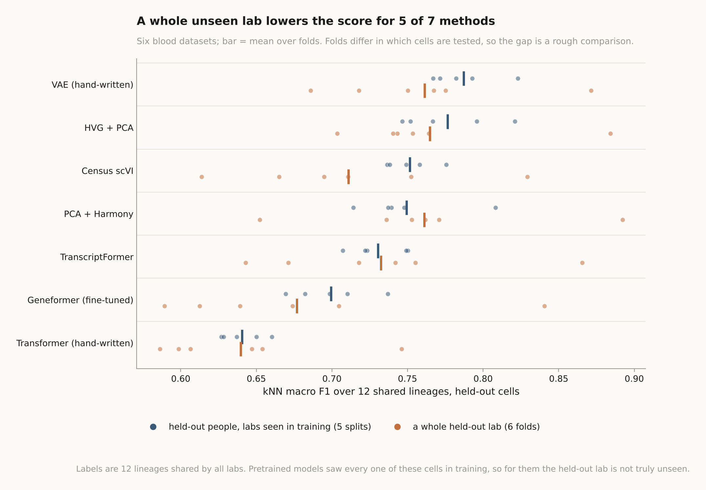

# November 18, 2026

Carried over from yesterday: does anything found on one dataset survive more data? Today was M4, plus two experiments that came out of preparing for an interview with Bindwell.

## Six labs

Six healthy blood datasets from Census, chosen for different labs and chemistries. 63,100 cells, 128 donors, at most 500 cells per donor, only the 19,110 genes all six labs measured. Labels mapped to 12 shared lineages because the labs name cells at different levels of detail; 541 cells with labels like "T cell" or "blood cell" were dropped.

Every method was run on 5 donor splits and 6 held-out-lab folds. The CPU methods ran here; the transformer ran on a Colab T4, pushing each fold to GitHub.

**No method passed the rule in either scheme. Macro F1 on a whole unseen lab: PCA 0.765, Harmony 0.761, VAE 0.761, pretrained models 0.68 to 0.73, hand-written transformer 0.640.**

The VAE is the story of the day. On one dataset it tied PCA and lost to Harmony. On six labs it is higher than PCA on scIB aggregate in 5 of 5 donor splits and higher than Harmony on macro F1 in 4 of 5. Not both on one measure, so not "better" by the rule, but the closest anything has come.

A headline I nearly published wrong: the first draft of this figure said "Holding out a whole lab costs every method". Harmony scored higher on held-out labs than on held-out people. The headline is now computed from the data (5 of 7 methods are lower).

## Held-out cell type

B cells removed from training still form their own group in every method and are called plasma cells, their closest relatives. Dendritic cells are called monocytes and lose some grouping, the VAE most (0.81 to 0.70). One split; a lead.

## Things that broke

- **The data script crashed on Colab** because it never created its output folder. It only worked here because the folder already existed. Fixed, and from now on every GPU notebook is replayed on a fresh clone here before it is handed over.
- **Colab disconnected after 9 of 11 folds.** The notebook resumed from the results branch and only trained the last two.
- **A background watcher hit its two-hour limit;** scheduled check-ins replaced it.

## Two extra experiments

**Leaky split.** Same method, cells split at random versus by person. On one dataset with 19 fine types the random split overstated macro F1 by 0.11 (0.776 against 0.664) and made results look far more stable than they are. On six labs with 12 lineages the gap was under 0.01. The size of a leak depends on how few independent sources you have and how fine the task is.

**Input probe.** Keep the trained model fixed, damage one part of the input, score again. The hand-written transformer scored the same with only "which genes are on" (0.375) as with the real input (0.366): it does not use expression amounts at all, which points at its input encoding as the reason it underperforms. The VAE uses both. Scrambling gene identities destroys both.

## Next

- M7: the analyses left in section 4.4 of the plan, the final write-up, and the checklist for making the repo public.
- Open: a better level encoding for the transformer (the probe says that is the bottleneck), a larger VAE code, and seurat_v3 gene selection.

Scripts: `scripts/m4_*.py`, `scripts/leakage_splits.py`, `scripts/probe_inputs.py`. Results: `results/m4/`, `results/leakage/`, `results/probe/`.
