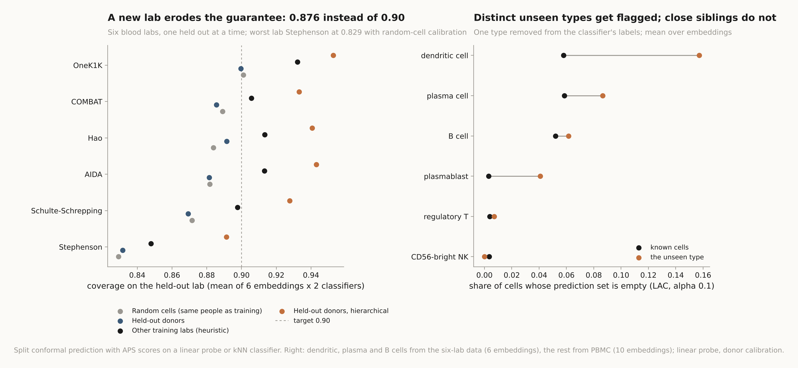

# November 19, 2026

Carried over: every result so far gives one label per cell. Today asked whether a classifier on these embeddings can say how sure it is, with a guarantee, and whether the guarantee survives new people and new labs.

## Conformal prediction

Seven hypotheses written down first, then a literature review that added hierarchical calibration (labs or donors as the exchangeable units) before any lab-fold result. Five supported, two partly.

**The promise holds for new donors (0.901) and erodes for a new lab (0.876; Stephenson 0.829) when calibrated on cells from the training people.** Lab-level hierarchical calibration restores it at 80 percent (every lab at least 0.893), with sets almost twice as big. At 90 percent, five labs are too few for any finite promise.

Unseen types get flagged by empty sets only when they are distinct: dendritic cells yes, regulatory T cells no. That repeats published work. The new part is the controlled comparison of cell, donor and lab calibration across many embeddings.

A side result: with a linear probe instead of kNN, TranscriptFormer goes from fifth to first on the 21-donor fine types. Rankings depend on the classifier used to read the embedding.

## Contrastive transformer

The same transformer, retrained to match two corrupted views of a cell (SimCLR) instead of filling in hidden genes, on a Colab GPU. Split 0: fine macro F1 0.506 against 0.366 for the masked-gene version, still below PCA (0.606). The model now uses expression levels (presence only 0.478). The hypotheses wait for all five splits.

## Things that broke

- **A careless `git checkout` discarded uncommitted conformal folds.** They were recomputed (deterministic, about 40 minutes).
- **The conformal run hit the two-hour background limit.** Added resume and ran it detached.
- **Colab could not find the GitHub token secret.** The notebook now falls back to a hidden prompt.
