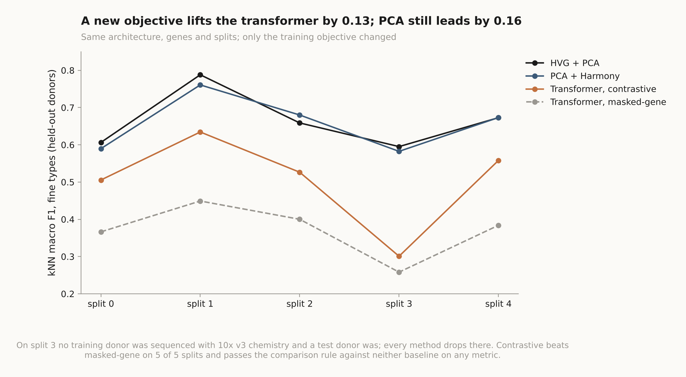
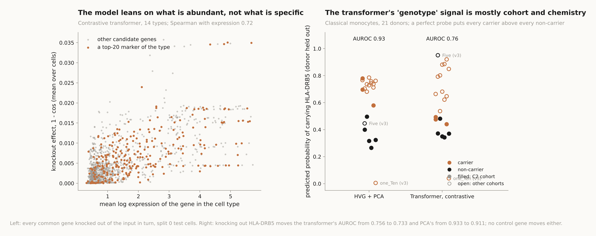

# November 22, 2026

Carried over: the contrastive transformer had split 0 in and three ablations done; the free Colab tier ran out overnight.

## Contrastive transformer, all five splits

Changing only the objective, from filling in hidden genes to matching two corrupted views of a cell, raised fine macro F1 from 0.371 to 0.505, on 5 of 5 splits. It still loses to PCA (0.664) and Harmony on all six declared metrics. Both pre-registered hypotheses held.

## Model audit

Asked what the transformer relies on, on CPU from the saved weights. Two of six predictions failed.

- Knocking genes out one at a time: the genes that matter track expression, not specificity, and match the markers no better than a "most expressed" list.
- The suspected genetic name tag, HLA-DRB5: removing it barely moves the transformer's carrier probe, and the probe's scores sort by cohort and chemistry. PCA does read the gene.

## Things that broke

- **The ablations notebook could not push:** the token in Colab Secrets was read-only. Nothing was lost; the owner is replacing it.
- **G2 passed on a technicality:** the control genes moved the probe by exactly zero, so any drop counted. Future causal tests get a minimum effect size.
