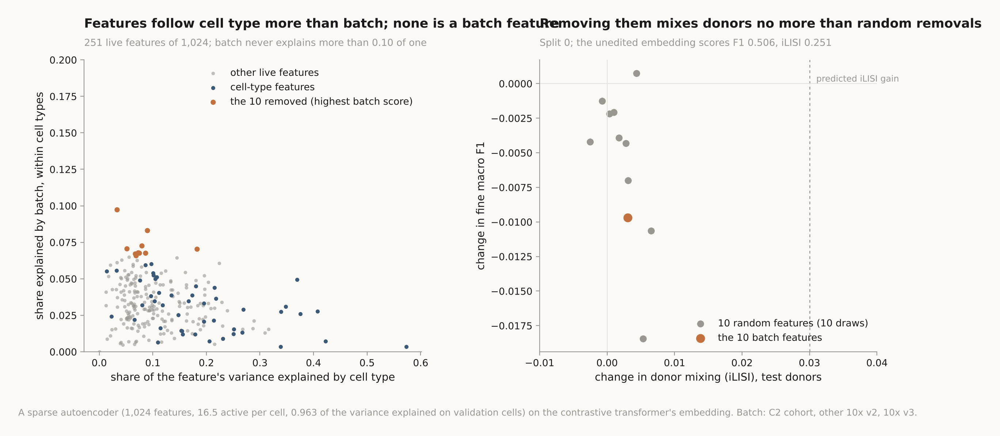

# November 23, 2026

Carried over: audit parts 1 and 2 said the donor shortcut is cohort and chemistry, not HLA-DRB5. Colab's free GPU allowance ran out, so the remaining ablations wait.

## Audit part 3: a sparse autoencoder

A sparse autoencoder written from scratch rewrites each embedding as a few of 1,024 features (16.5 active per cell, 0.963 of the variance kept). Two of four predictions held.

- Every coarse cell type has its own features.
- No feature separates the sample cohorts (best AUROC 0.68), and removing the most batch-linked features mixes donors no more than removing random ones.

Reading: the batch signal is spread thinly, so it cannot be cut out after training; the one-donor-per-batch training change could.

## Housekeeping

- PR #3 merged into `main` once GitHub's delayed checks ran green.
- The plan's design entry said 8 coarse types; there are 10. Recorded in the decision log; the verdict does not change.
